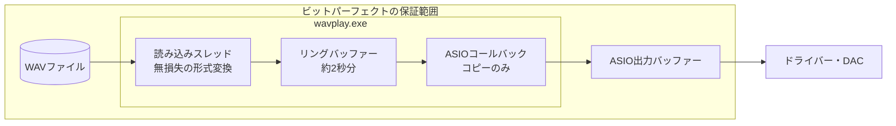
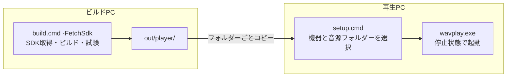

# WAV Player

WAVファイルのサンプル値を変えずにASIOドライバーへ出力する、Windows 11向けの音楽プレーヤーです。音量調整・リサンプリング・ディザー・フェード・エフェクトといったサンプル値を変える処理を持たず、WAVファイルからASIO出力バッファーまでのサンプル値の一致（ビットパーフェクト）を保証します。



公開しているのはソースコードです。実行ファイルは[各自でビルド](#ビルドから再生まで)します。

## 対応範囲

| 項目 | 対応 |
|---|---|
| コンテナー | RIFF/WAVE、RF64（4 GiBを超えるファイルを含む） |
| サンプル形式 | PCM 16/24/32 bit、IEEE Float32 |
| チャンネル | ステレオ、モノ（左右に同じ値を出力） |
| サンプルレート | 44.1／48／88.2／96／176.4／192／352.8／384 kHz |
| 出力先 | x64 ASIOドライバーの隣り合う出力ペア（1/2、3/4、…） |

機器の出力型が入力形式の全範囲を無損失で表現できる場合だけ再生します。たとえばPCM24の曲は、有効24 bit以上の整数かFloat32/64の出力で再生できます。[組み合わせの一覧](docs/requirements.md#無損失で再生できる組み合わせ)

## 必要な環境

| PC | 必要なもの |
|---|---|
| 再生PC | Windows 11 25H2以降（x64）<br>AVX2・BMI1/BMI2・LZCNT・MOVBE・FMA・F16Cに対応するCPU<br>使用する機器のx64 ASIOドライバー |
| ビルドPC | 再生PCと同じCPU条件（ビルド中に試験を実行するため）<br>Visual Studio 2026安定版のC++デスクトップ開発環境（MSVC v145、Windows SDK 10.0.26100.0） |

- Visual Studioに必要なコンポーネントは [.vsconfig](.vsconfig) に定義しています。
- Steinberg ASIO SDK 2.3.4は、ビルド時に公式の配布元から取得します。[取得先・ハッシュ・ライセンス](docs/dependencies.md)
- 製品はCRTを静的リンクするため、再生PCにVisual StudioやSDKは不要です。
- 条件を満たさない環境では、起動時に理由を表示して終了します。

## ビルドから再生まで



### ビルド

```powershell
git clone https://github.com/ponta2git/wav-player.git
cd wav-player
.\build.cmd -FetchSdk
```

`build.cmd` は次の順に進みます。試験には模擬ASIOを使うため、ビルドPCにドライバーや機器は不要です。

1. `-FetchSdk` を付けた場合、ASIO SDKの公式ZIPを取得し、SHA-256を照合して `external/asiosdk/` に展開します。
2. Release x64をビルドし、成果物の監査と自動試験を行います。
3. `wavplay.exe` とセットアップ用のスクリプトを、再生用フォルダー `out/player/` にまとめます。

| 場面 | コマンド |
|---|---|
| 初回（SDKを取得する） | `.\build.cmd -FetchSdk` |
| SDKを配置済み | `.\build.cmd` |
| 再ビルド（既存の出力先は上書きしない） | `.\build.cmd -OutputDirectory "新しい出力先"` |

### セットアップ

1. `out/player/` をフォルダーごと、再生PCの書き込み可能なローカルフォルダーへコピーします。ビルドしたPCで再生する場合は `out/player/` をそのまま使えます。
2. `setup.cmd` を実行し、ASIOドライバーを番号で選び、WAVを置いたフォルダーを入力します（サブフォルダーも対象）。`settings.ini` と `playlist.txt` が `wavplay.exe` の隣に作られ、プレーヤーが停止状態で起動します。
3. 画面の機器・出力・曲一覧を確認し、Playを押します。

プレーヤーに音量調整はありません。音量は機器側で設定してから再生してください。

`setup.cmd` を再実行しても、既存の `settings.ini` と `playlist.txt` は書き換えません。曲一覧を作り直すときは、プレーヤーを終了して `setup.cmd -UpdatePlaylist` を実行します。以前の一覧は `.bak` として残ります。[再生用フォルダーのREADME](packaging/player/README.txt)

### 操作と再生動作

| 操作 | 動作 |
|---|---|
| Play/Pause・Space | 再生、一時停止、再開。曲が未選択なら先頭の曲から再生する |
| Stop・Escape | 再生を打ち切り、位置を曲の先頭へ戻す |
| 曲のダブルクリック・一覧でEnter | 選択した曲を先頭から再生する |

シーク、リピート、シャッフル、曲一覧の編集、画面上での機器選択はありません。

| 場面 | 動作 |
|---|---|
| 同じサンプルレートの曲が続く | 無音を挟まずに連続再生する |
| サンプルレートが変わる | 機器のレートを切り替えてから次の曲を再生する。曲間に無音が入る |
| 一時停止・停止・再開 | 波形を加工しないため、その境界でクリックが生じることがある |
| 無損失で出力できない曲、機器が受け付けないレート | その曲を選択して停止し、理由を表示する |
| 再生データの供給が間に合わない（アンダーラン） | 無音で埋めて続けず、停止する |

[操作と表示の仕様](docs/requirements.md#プレイリストと操作)

### 設定

`settings.ini` と `playlist.txt` は起動時に一度だけ読みます。変更するときはプレーヤーを終了してから編集します。

```ini
[General]
SelectedDevice={ASIOドライバーのCLSID}

[Device.{ASIOドライバーのCLSID}]
Name=表示名
OutputPair=1
BufferSize=0
StartSilence=100
```

| キー | 未指定時 | 意味 |
|---|---|---|
| `SelectedDevice` | `NO DEVICE` と表示し、再生しない | 使用するx64 ASIOドライバーのCLSID。再生用フォルダーの `check-asio-drivers.ps1` で一覧できる |
| `Name` | CLSIDを表示 | 画面に表示する機器名 |
| `OutputPair` | 1 | 出力ペアの先頭チャンネル。1は出力1/2、3は出力3/4 |
| `BufferSize` | 0 | バッファー幅（フレーム）。0はドライバーの推奨幅を使い、正の値はその幅を厳密に要求する。ドライバーが指定幅を記憶する場合、以後の推奨幅（ほかのアプリが使う値を含む）も変わる |
| `StartSilence` | 100 | 再生開始・再開・レート切替のとき、最初の音声の前に出す無音（0～1000 ms、バッファー単位に切り上げ） |

範囲外の値や機器が受け付けない値は、別の値に置き換えずに再生を拒否します。

`playlist.txt` はUTF-8で、1行に1曲のローカル絶対パスを書きます。空行と `#` で始まる行は読み飛ばします。ネットワーク上のファイル、存在しないファイル、WAVとして解析できないファイルは一覧から除外し、件数を表示します。

[設定例](settings.example.ini)・[設定の仕様](docs/requirements.md#設定と診断)

## 文書

| 文書 | 内容 |
|---|---|
| [製品要件](docs/requirements.md) | 対応範囲と受け入れ条件 |
| [アーキテクチャ](docs/architecture.md) | 層の責務と依存方向、スレッド、再生経路 |
| [ASIO契約](docs/asio-contract.md) | SDKの規定とホスト側の方針 |
| [試験仕様](docs/test-specification.md) | 自動検証と実機での確認手順 |
| [開発手順](docs/development.md) | 記録の保存先、変更の流れ、コミット前の確認、版とタグ |
| [依存とライセンス](docs/dependencies.md) | SDKの取得、公開範囲、第三者の条件 |

PRとIssueを受け付けています。変更を加えるときは[開発手順](docs/development.md)を参照してください。

## ライセンス

このリポジトリの自作ファイル（ソースコード、スクリプト、文書、設定・ビルド定義）は **GNU GPL version 3 only**（SPDX: `GPL-3.0-only`）で提供します。[ライセンス本文](LICENSE)

ASIO SDK、Visual Studio、Windows SDK、ランタイムなど第三者の成果物には、それぞれの権利者の条件が適用されます。ビルドしたバイナリを再配布するときは、GPLの対応ソースの提供と、静的リンクしたランタイムの再配布条件を確認してください。[バイナリを再配布する場合](docs/dependencies.md#バイナリを再配布する場合)
