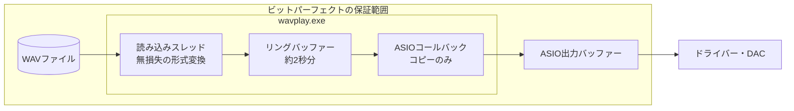
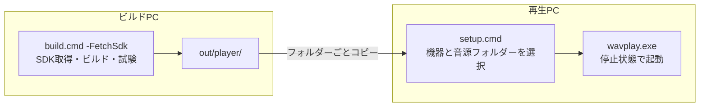

# WAV Player

WAVファイルのサンプル値を変えずにASIOドライバーへ出力する、Windows 11向けの音楽プレーヤーです。音量調整・リサンプリング・ディザー・フェード・エフェクトといったサンプル値を変える処理を持たず、WAVファイルからASIO出力バッファーまでのサンプル値の一致（ビットパーフェクト）を保証します。



公開しているのはソースコードです。実行ファイルは[各自でビルド](#ビルドから再生まで)します。

## 対応範囲

| 項目 | 対応 |
|---|---|
| コンテナー | RIFF/WAVE、RF64（4 GiBを超えるファイルを含む） |
| サンプル形式 | PCM 16/24/32 bit、IEEE Float32 |
| チャンネル | ステレオ、モノ（左右に同じ値を出力） |
| サンプルレート | 44.1／48／88.2／96／176.4／192／352.8／384 kHz |
| 出力先 | x64 ASIOドライバーの隣り合う出力ペア（1/2、3/4、…） |

機器の出力型が入力形式の全範囲を無損失で表現できる場合だけ再生します。たとえばPCM24の曲は、有効24 bit以上の整数かFloat32/64の出力で再生できます。[組み合わせの一覧](docs/requirements.md#無損失で再生できる組み合わせ)

## 必要な環境

| PC | 必要なもの |
|---|---|
| 再生PC | Windows 11 25H2以降（x64）<br>AVX2・BMI1/BMI2・LZCNT・MOVBE・FMA・F16Cに対応するCPU<br>使用する機器のx64 ASIOドライバー |
| ビルドPC | 再生PCと同じCPU条件（ビルド中に試験を実行するため）<br>Visual Studio 2026安定版のC++デスクトップ開発環境（MSVC v145、Windows SDK 10.0.26100.0） |

- Visual Studioに必要なコンポーネントは [.vsconfig](.vsconfig) に定義しています。
- Steinberg ASIO SDK 2.3.4は、ビルド時に公式の配布元から取得します。[取得先・ハッシュ・ライセンス](docs/dependencies.md)
- 製品はCRTを静的リンクするため、再生PCにVisual StudioやSDKは不要です。
- 条件を満たさない環境では、起動時に理由を表示して終了します。

## ビルドから再生まで



### ビルド

```powershell
git clone https://github.com/ponta2git/wav-player.git
cd wav-player
.\build.cmd -FetchSdk
```

`build.cmd` は次の順に進みます。試験には模擬ASIOを使うため、ビルドPCにドライバーや機器は不要です。

1. `-FetchSdk` を付けた場合、ASIO SDKの公式ZIPを取得し、SHA-256を照合して `external/asiosdk/` に展開します。
2. Release x64をビルドし、成果物の監査と自動試験を行います。
3. `wavplay.exe` とセットアップ用のスクリプトを、再生用フォルダー `out/player/` にまとめます。

| 場面 | コマンド |
|---|---|
| 初回（SDKを取得する） | `.\build.cmd -FetchSdk` |
| SDKを配置済み | `.\build.cmd` |
| 再ビルド（既存の出力先は上書きしない） | `.\build.cmd -OutputDirectory "新しい出力先"` |

### セットアップ

1. `out/player/` をフォルダーごと、再生PCの書き込み可能なローカルフォルダーへコピーします。ビルドしたPCで再生する場合は `out/player/` をそのまま使えます。
2. `setup.cmd` を実行し、ASIOドライバーを番号で選び、WAVを置いたフォルダーを入力します（サブフォルダーも対象）。`settings.ini` と `playlist.txt` が `wavplay.exe` の隣に作られ、プレーヤーが停止状態で起動します。
3. 画面の機器・出力・曲一覧を確認し、Playを押します。

プレーヤーに音量調整はありません。音量は機器側で設定してから再生してください。

`setup.cmd` を再実行しても、既存の `settings.ini` と `playlist.txt` は書き換えません。曲一覧を作り直すときは、プレーヤーを終了して `setup.cmd -UpdatePlaylist` を実行します。以前の一覧は `.bak` として残ります。[再生用フォルダーのREADME](packaging/player/README.txt)

### 操作と再生動作

| 操作 | 動作 |
|---|---|
| Play/Pause・Space | 再生、一時停止、再開。曲が未選択なら先頭の曲から再生する |
| Stop・Escape | 再生を打ち切り、位置を曲の先頭へ戻す |
| 曲のダブルクリック・一覧でEnter | 選択した曲を先頭から再生する |

シーク、リピート、シャッフル、曲一覧の編集、画面上での機器選択はありません。

| 場面 | 動作 |
|---|---|
| 同じサンプルレートの曲が続く | 無音を挟まずに連続再生する |
| サンプルレートが変わる | 機器のレートを切り替えてから次の曲を再生する。曲間に無音が入る |
| 一時停止・停止・再開 | 波形を加工しないため、その境界でクリックが生じることがある |
| 無損失で出力できない曲、機器が受け付けないレート | その曲を選択して停止し、理由を表示する |
| 再生データの供給が間に合わない（アンダーラン） | 無音で埋めて続けず、停止する |
| 最後の曲の終わり | 停止する |

[操作と表示の仕様](docs/requirements.md#プレイリストと操作)

### 設定

`settings.ini` と `playlist.txt` は起動時に一度だけ読みます。変更するときはプレーヤーを終了してから編集します。

```ini
[General]
SelectedDevice={ASIOドライバーのCLSID}

[Device.{ASIOドライバーのCLSID}]
Name=表示名
OutputPair=1
BufferSize=0
StartSilence=100
```

| キー | 未指定時 | 意味 |
|---|---|---|
| `SelectedDevice` | `NO DEVICE` と表示し、再生しない | 使用するx64 ASIOドライバーのCLSID。再生用フォルダーの `check-asio-drivers.ps1` で一覧できる |
| `Name` | CLSIDを表示 | 画面に表示する機器名 |
| `OutputPair` | 1 | 出力ペアの先頭チャンネル。1は出力1/2、3は出力3/4 |
| `BufferSize` | 0 | バッファー幅（フレーム）。0はドライバーの推奨幅を使い、正の値はその幅を厳密に要求する。ドライバーが指定幅を記憶する場合、以後の推奨幅（ほかのアプリが使う値を含む）も変わる |
| `StartSilence` | 100 | 再生開始・再開・レート切替のとき、最初の音声の前に出す無音（0～1000 ms、バッファー単位に切り上げ） |

範囲外の値や機器が受け付けない値は、別の値に置き換えずに再生を拒否します。

`playlist.txt` はUTF-8で、1行に1曲のローカル絶対パスを書きます。空行と `#` で始まる行は読み飛ばします。ネットワーク上のファイル、存在しないファイル、WAVとして解析できないファイルは一覧から除外し、件数を表示します。

[設定例](settings.example.ini)・[設定の仕様](docs/requirements.md#設定と診断)

## 開発

### 文書

| 文書 | 内容 |
|---|---|
| [製品要件](docs/requirements.md) | 対応範囲と受け入れ条件 |
| [アーキテクチャ](docs/architecture.md) | 層の責務と依存方向、スレッド、再生経路 |
| [ASIO契約](docs/asio-contract.md) | SDKの規定とホスト側の方針 |
| [試験仕様](docs/test-specification.md) | 自動検証と実機での確認手順 |
| [依存とライセンス](docs/dependencies.md) | SDKの取得、公開範囲、第三者の条件 |

### リポジトリの構成

| パス | 内容 | Git |
|---|---|---|
| `src/app/` | 製品の入口（`wavplay.exe`） | 追跡 |
| `src/wavplay/<層>/` | 層ごとの製品コード。製品と試験が同じオブジェクトをリンクする | 追跡 |
| `tests/wavplay_tests/` | 自動試験と模擬ASIO（`wavplay_tests.exe`） | 追跡 |
| `scripts/`、`build/` | ビルド・検証のスクリプト、共通のビルド設定、公開対象一覧 | 追跡 |
| `packaging/player/` | 再生用フォルダーに入れるセットアップ一式 | 追跡 |
| `docs/` | 現行の要件・設計・契約・試験手順 | 追跡 |
| `external/asiosdk/` | 取得したASIO SDK | 対象外 |
| `out/` | ビルドの生成物と再生用フォルダー | 対象外 |
| `private/` | 実験と実機の記録。`notes/`（実験メモ）、`experiments/`（途中の実験仕様）、`results/`（実機記録）、`publication/`（公開準備の監査記録） | 対象外 |

Visual Studioでは [WAV Player.sln](WAV%20Player.sln) を開き、Debug／Release x64をビルドします。

### 検証

全検証は次のコマンドで実行します。ドライバーの登録や機器の接続は不要です。

```powershell
powershell -NoProfile -ExecutionPolicy Bypass -File .\scripts\verify.ps1 -Analyze -IncludeASan
```

| 段階 | 内容 |
|---|---|
| 構成の監査 | ソースの登録、層の依存、文書のリンク、評価済みのビルド設定 |
| ビルド | Debug・Release（静的解析付き）、Debug-ASan |
| 成果物の監査 | マニフェスト、版情報、ReleaseのPEと機械語 |
| 試験 | ReleaseとDebug-ASanで、模擬ASIOを使う全試験群 |

試験群を個別に実行するには、`out\x64\Release\wavplay_tests.exe --list` で名前を調べ、`--suite 群名` を指定します。

GitHub Actionsは、PRと `main` へのpushでこの全検証を実行します。ReleaseとDebug／ASanを2台のWindowsランナーで並列に検証し、両方の成功で `Full verification` が通ります。Release側では公開対象の監査、PowerShellスクリプトの回帰試験、製品EXEの起動確認も行います。手動実行の `release_only` は、静的解析とASanを省いてReleaseだけを調べる `Release diagnostics` です。

公開ログに出すのは、工程別の所要時間、合否、失敗したケースの名前・ソース位置・数値の期待値と実測値です。それ以上の詳細は、同じコマンドをローカルで実行して調べます。実行ファイルはartifactにもReleaseにも置きません。[試験仕様](docs/test-specification.md#ローカルとciの全検証)

### 変更の流れ

| 変更 | 経路 | 反映の条件 |
|---|---|---|
| 通常の変更（エージェントによる変更を含む） | 作業ブランチからPR | 最新の `main` に追従したPRで `Full verification` が成功し、所有者が差分を確認してマージする |
| 所有者が軽微と判断した変更（文書の訂正など） | 所有者が `main` へ直接push | pushの後に実行される `Full verification` の結果を所有者が確認する |

`main` の削除とforce pushは禁止で、直線履歴を保ちます。この規則は所有者にも適用されます。承認レビューは必須にしていません。

外部からのPRとIssueを受け付けています。採否と対応時期は所有者が判断します。

### コミット前の確認

コミットに記録する氏名とメールは公開されます。cloneごとに公開用の値を設定し、表示を確認してからコミットします。メールにはGitHubのnoreplyアドレスを使えます。

```powershell
git config --local user.name "YOUR_PUBLIC_NAME"
git config --local user.email "YOUR_PUBLIC_EMAIL"
git var GIT_AUTHOR_IDENT
git var GIT_COMMITTER_IDENT
```

`git status`、`git diff`、`git diff --cached` で変更と追加対象を確認し、次を実行します。

```powershell
git diff --check
git diff --cached --check
# Gitが追跡するファイルと公開対象一覧の一致
powershell -NoProfile -ExecutionPolicy Bypass -File .\scripts\check-public-source.ps1 -Tracked
# Visual Studioへの登録、層の依存、文書のリンク
powershell -NoProfile -ExecutionPolicy Bypass -File .\scripts\check-project-layout.ps1
```

- ファイルを追加・移動・削除するときは、[公開対象一覧](build/public-files.txt)とVisual Studioの登録を同じ変更で更新します。
- スクリプトが確認するのはファイルの構成です。本文とコメントの内容、コミットの氏名・メール・メッセージは、コミット前とpush前に自分で確認します。
- 実験の実測値や作業の経緯は、コメントを含む公開ファイルに書かず `private/` に置きます。公開する説明は、現行の契約・設計意図・検証手順に絞ります。

## バージョンとタグ

公開版の区切りには、注釈付きタグ `vメジャー.マイナー.パッチ` を付けます。

| 段階 | パッチ | マイナー | メジャー |
|---|---|---|---|
| `0.x`（互換性を固定しない初期開発） | 互換性を保つ不具合修正 | 機能追加、互換性を変える変更 | — |
| `1.0.0` 以降 | 互換性を保つ不具合修正 | 機能追加 | 互換性を壊す変更 |

- `0.x` の間は、互換性への影響をPRで説明します。設定形式・起動引数・基本的な利用方法の互換性を維持すると判断した時点で、`1.0.0` に進めます。
- Windowsの製品バージョンは `メジャー.マイナー.パッチ.0` です（タグ `v0.1.0` は `0.1.0.0`）。[リソース](src/app/wavplay.rc)と[マニフェスト](build/app.manifest)を同じPRで更新します。
- 文書だけの変更では、通常は版を上げません。

公開版は次の手順で作ります。

1. 版番号の更新と変更説明を含むPRを、`Full verification` の成功後に所有者がレビューして `main` へマージします。
2. レビュー済みの `main` のコミットをタグの対象に決め、PR上の結果ではなく、そのSHAに対する `push` の `Full verification` の成功を確認します。CIはタグのpushでは起動しないため、この結果がタグ対象の検証結果になります。
3. 所有者が公開する版を決め、対象ソースの版番号、公開対象、既存タグとの重複を確認します。`git var GIT_COMMITTER_IDENT` でタグに記録する氏名・メールを確かめ、対象コミットの完全なSHAを指定して注釈付きタグを作ります。注釈には版と公開する変更点だけを書きます。
4. 作成したタグ1つだけをpushし、リモートのタグが対象のコミットを指すことを確認します。

`v*` タグを作成できるのは所有者だけで、更新と削除は例外なく禁止しています。公開済みのタグは移動・再利用せず、修正は新しい版として公開します。

GitHub Releaseの作成は任意です。作る場合も、変更説明とGitHubのソースアーカイブだけを使い、SDK・バイナリ・実機記録は添付しません。

## ライセンス

このリポジトリの自作ファイル（ソースコード、スクリプト、文書、設定・ビルド定義）は **GNU GPL version 3 only**（SPDX: `GPL-3.0-only`）で提供します。[ライセンス本文](LICENSE)

ASIO SDK、Visual Studio、Windows SDK、ランタイムなど第三者の成果物には、それぞれの権利者の条件が適用されます。ビルドしたバイナリを再配布するときは、GPLの対応ソースの提供と、静的リンクしたランタイムの再配布条件を確認してください。[バイナリを再配布する場合](docs/dependencies.md#バイナリを再配布する場合)
